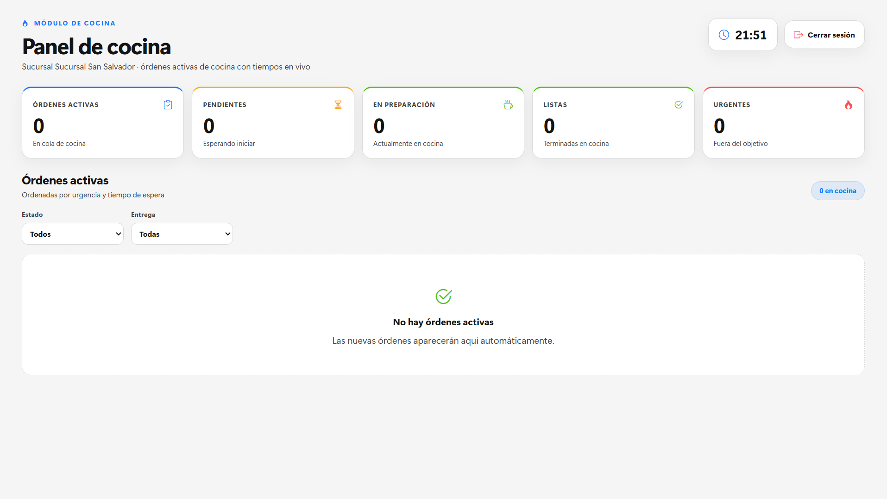
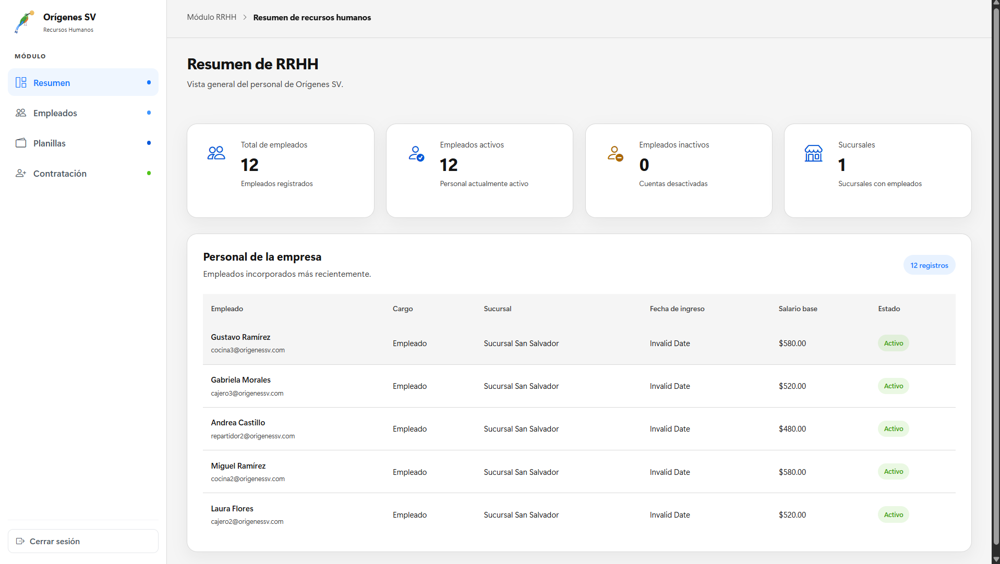
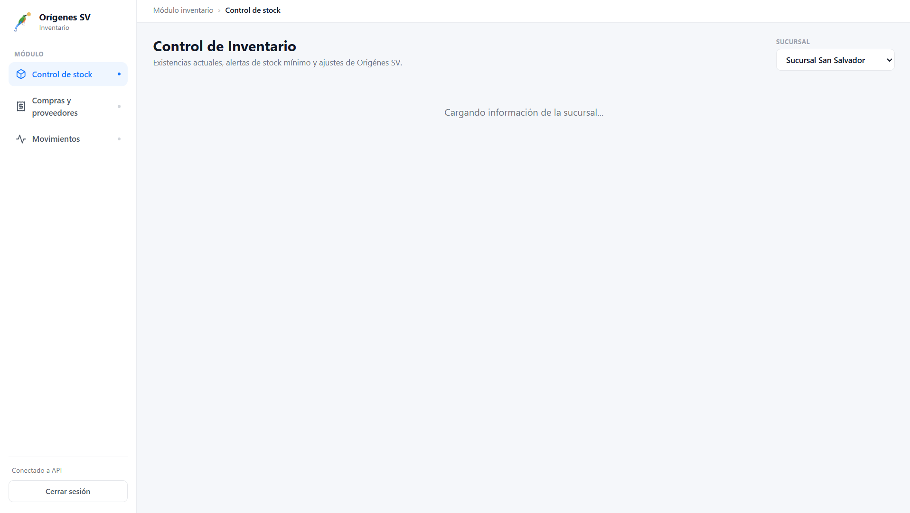
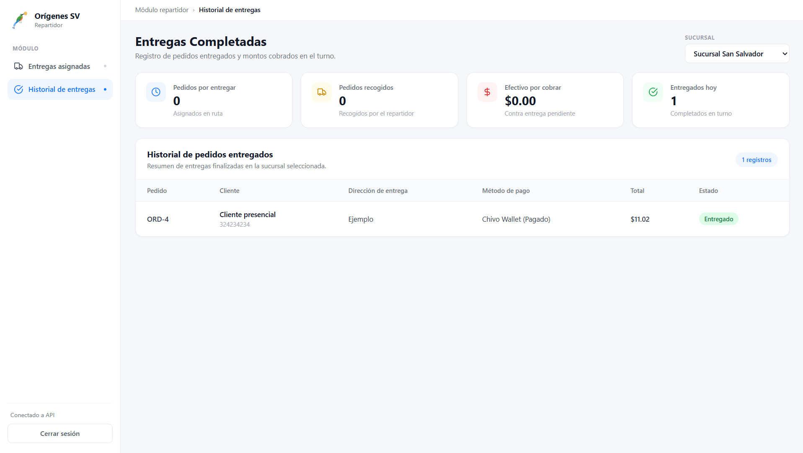
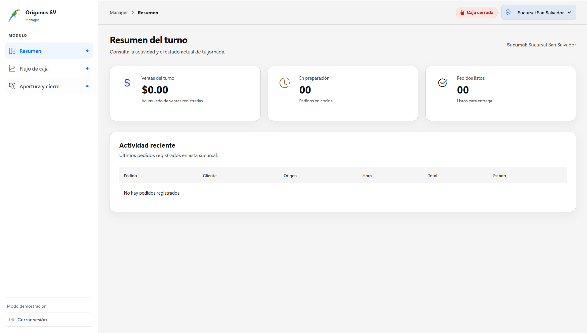
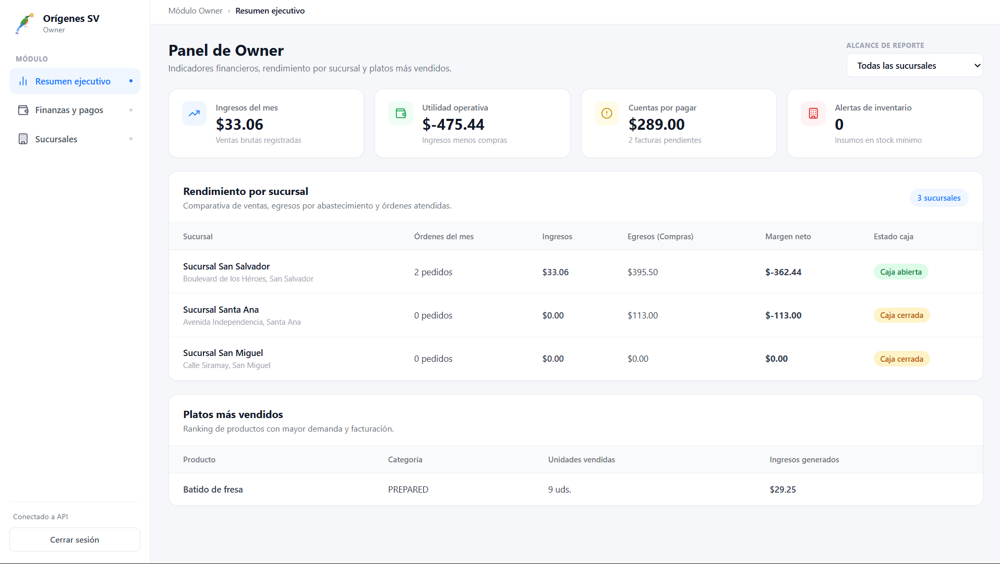

# Orígenes SV

**ERP / POS para restaurante**

Frontend y backend real para operar ventas, cocina, entregas, inventario, recursos humanos, caja y reportes.

`React 18` · `Vite 8` · `React Router 7` · `Bootstrap 5`

</div>

---

## Vista general

| Aspecto | Detalle |
| --- | --- |
| Tipo de proyecto | ERP/POS con backend real y PostgreSQL |
| Datos | Persistidos en PostgreSQL; se cargan con los scripts de `scripts-sql/` |
| Rutas | `frontend/src/routes/AppRoutes.jsx` |
| Estado compartido | `frontend/src/context/OrderContext.jsx` |
| Alcance de este README | Páginas vigentes, sus verificaciones y la estructura actual |

> Este documento se enfoca únicamente en las páginas actuales del sistema y en cómo comprobarlas.

---

## Inicio rápido

Ejecutar en la primera terminal el backend
```bash
cd backend
npm install
npm run dev
```

Ejecutar en la segunda terminal el frontend
```bash
cd frontend
npm install
npm run dev
```

| Comando | Uso |
| --- | --- |
| `npm run dev` | Levanta el servidor local de Vite |
| `npm run build` | Genera el build de producción |
| `npm run preview` | Previsualiza el build generado |

---

## Mapa de rutas

| Página | Ruta | Archivo principal |
| --- | --- | --- |
| Acceso | `/` y `/login` | `pages/auth/LoginPage.jsx` |
| Cajero | `/cajero` | `pages/cashier/CashierPage.jsx` |
| Cocina | `/chef` | `pages/chef/ChefPage.jsx` |
| Recursos Humanos | `/rrhh` | `pages/hr/HrPage.jsx` |
| Inventario | `/inventario` | `pages/inventory/InventoryPage.jsx` |
| Repartidor | `/repartidor` | `pages/delivery/DeliveryPage.jsx` |
| Manager | `/manager` | `pages/manager/ManagerPage.jsx` |
| Owner | `/gerencia` | `pages/owner/OwnerPage.jsx` |

---

## Páginas y verificaciones

Cada bloque resume la funcionalidad actual y los puntos que conviene comprobar manualmente.

### Acceso — `/` y `/login`

**Funcionalidad**

- Formulario de demostración con usuario, contraseña y botón para mostrar/ocultar la clave.
- Validación de campos vacíos y mensaje de bienvenida tras una espera simulada.
- Tarjetas directas a Cajero, Cocina, RRHH, Inventario, Repartidor, Manager y Owner.
- Manager y Owner son módulos separados: `/manager` y `/gerencia`.

**Verificación**

| Caso | Resultado esperado |
| --- | --- |
| Abrir `/` o `/login` | Se muestra la misma página de acceso. |
| Enviar el formulario vacío | Aparece una alerta pidiendo usuario y contraseña. |
| Enviar cualquier usuario y contraseña | Se muestra carga y luego un mensaje de bienvenida demostrativo. |
| Alternar el icono del ojo | La contraseña se muestra u oculta. |
| Usar las tarjetas de módulos | Cada tarjeta navega a su ruta correspondiente. |

---

### Cajero — `/cajero`

**Funcionalidad**

- Punto de venta con catálogo, búsqueda, carrito y control de stock.
- Selección de sucursal compartida con Cocina, Inventario, Repartidor y Manager.
- Registro de cliente, método de pago, tipo de entrega y tiempo de preparación, todos obligatorios y validados.
- Venta local o a domicilio con dirección, número de casa y teléfono; para pagos distintos de efectivo se exige referencia de pago.
- Las ventas se registran en `OrderContext` y aparecen en Cocina.
- La sección Órdenes permite cambiar el estado de pedidos locales. Los pedidos a domicilio se gestionan desde Repartidor.
- Si la caja está cerrada, el POS queda bloqueado.

**Verificación**

| Caso | Resultado esperado |
| --- | --- |
| Intentar vender con la caja cerrada | Aparece el banner de caja cerrada y no se permite confirmar la venta. |
| Dejar cliente, tipo de orden, tiempo de preparación o método de pago sin completar | No se emite la factura y se muestran los errores en cada campo. |
| Elegir tarjeta, Bitcoin o Chivo sin referencia de pago | Se exige una referencia válida antes de registrar la venta. |
| Ingresar un teléfono de domicilio inválido | Se muestra el error de formato y no se registra la venta. |
| Superar el stock disponible | El carrito no permite agregar más unidades que el stock. |
| Elegir entrega a domicilio sin dirección, casa o teléfono | Se muestra el mensaje de datos incompletos. |
| Confirmar una venta local | El pedido aparece en Cocina y en la sección Órdenes del Cajero. |
| Confirmar una venta a domicilio | El pedido aparece en Repartidor como `Por llamada` con estado `READY`. |
| Cambiar de sucursal | Cambia el encabezado, el stock mostrado y la caja de esa sucursal. |
| Cambiar estado de un pedido local | El estado se actualiza en la lista de órdenes. |
| Cambiar estado de un pedido por llamada | El Cajero lo ve bloqueado como `Delivery`; en Repartidor se gestionan `ORD-3048` y `ORD-3047`. |

---

### Cocina — `/chef`

**Funcionalidad**

- Tablero de solo lectura para las órdenes de la sucursal activa.
- Muestra únicamente estados activos: `Pendiente` y `En preparación`.
- Calcula urgencia según el tiempo objetivo del pedido.
- Actualiza tiempos en vivo cada segundo.
- Indica pedidos para entrega a domicilio.
- Ordena primero los pedidos urgentes y luego por antigüedad.

**Verificación**

| Caso | Resultado esperado |
| --- | --- |
| Abrir Cocina | Se listan las órdenes activas de la sucursal seleccionada. |
| Buscar botones de edición | No existen acciones para modificar pedidos: el módulo es solo lectura. |
| Crear un pedido desde Cajero | El pedido aparece automáticamente en Cocina. |
| Esperar el tiempo objetivo | La orden cambia a estado visual de retraso o urgencia. |
| Revisar un pedido a domicilio | Se muestra la marca correspondiente de entrega. |
| Cambiar de sucursal en el contexto compartido | Cocina muestra las órdenes de la nueva sucursal. |



---

### Recursos Humanos — `/rrhh`

**Funcionalidad**

- Navegación entre Resumen, Empleados, Planillas y Contratación.
- Lista de empleados con búsqueda, filtros por sucursal y rol.
- Cargo derivado automáticamente del rol del sistema.
- Contratación con validación de nombre, correo, correo duplicado, sucursal y salario.
- Generación de usuario y contraseña temporal demostrativos.
- Planillas con cálculos de ISSS, AFP, renta y neto quincenal.

**Verificación**

| Caso | Resultado esperado |
| --- | --- |
| Recorrer las pestañas | Resumen, Empleados, Planillas y Contratación cargan sin errores. |
| Buscar o filtrar empleados | La tabla se actualiza por nombre, correo, rol o sucursal. |
| Contratar con datos incompletos | Se muestran mensajes de validación. |
| Repetir un correo existente | Se bloquea la contratación e indica que el correo ya existe. |
| Contratar con datos válidos | El empleado aparece en la lista y en planillas con credenciales demo. |
| Revisar el cargo | El cargo mostrado depende del rol seleccionado, no de un campo manual. |
| Revisar una planilla | Se muestran los descuentos y el neto correspondiente. |



---

### Inventario — `/inventario`

**Funcionalidad**

- Pestañas de Stock, Compras y Movimientos.
- Stock por sucursal con alertas de mínimo y agotado.
- Ajuste manual de inventario con motivo obligatorio.
- Registro de facturas de abastecimiento y aumento de stock.
- Cuentas por pagar y registro de abonos a proveedores.
- Bitácora de movimientos con búsqueda y filtro por tipo.
- Usa la sucursal compartida del contexto.

**Verificación**

| Caso | Resultado esperado |
| --- | --- |
| Cambiar de sucursal | KPIs, tablas y movimientos cambian a la sucursal elegida. |
| Revisar alertas | Los insumos en mínimo o agotados se resaltan correctamente. |
| Ajustar inventario sin motivo | Se muestra error y no se guarda el ajuste. |
| Confirmar un ajuste válido | El stock se actualiza y se muestra confirmación. |
| Registrar factura de compra | La factura aparece en Compras y el stock se incrementa. |
| Registrar abono | El saldo pendiente de la factura se reduce. |
| Filtrar movimientos | La bitácora responde a búsqueda y tipo de movimiento. |



---

### Repartidor — `/repartidor`

**Funcionalidad**

- Gestión de entregas activas e historial.
- Recibe pedidos a domicilio creados desde Cajero; se identifican como `Por llamada`.
- Flujo de estados: `READY → IN_TRANSIT → DELIVERED`.
- El repartidor marca `Pedido recogido` y luego `Entregado`.
- Muestra dirección, teléfono, método de pago y monto a cobrar.
- Los pedidos por llamada se cobran en efectivo contra entrega y el pago pasa a `COLLECTED` al entregar.
- Usa la sucursal compartida del contexto.
- Las entregas se leen directamente de la API; no hay modo demostración ni datos mock.

**Verificación**

| Caso | Resultado esperado |
| --- | --- |
| Crear un pedido a domicilio desde Cajero | Aparece en Repartidor como `Por llamada` con estado `READY`. |
| Avanzar el estado | Pasa a `IN_TRANSIT` con `Pedido recogido` y luego a `DELIVERED` con `Entregado`. |
| Revisar pedido con pago pendiente | Se muestra el monto a cobrar al entregar. |
| Confirmar la entrega | El pedido pasa al historial y el pago queda cobrado si era efectivo. |
| Cambiar de sucursal | La lista se filtra por la sucursal activa. |
| Abrir sin backend | Se muestra el error de conexión; la API debe estar encendida. |



---

### Manager — `/manager`

**Funcionalidad**

- Secciones de Resumen, Flujo de caja y Apertura/Cierre.
- Resumen del turno con ventas y métricas de la sucursal.
- Flujo de caja calculado con las órdenes de la sucursal.
- Apertura de caja con monto inicial y cierre con monto final.
- El estado de caja se comparte con Cajero y Owner.
- Cada sucursal mantiene su propio estado de caja.

**Verificación**

| Caso | Resultado esperado |
| --- | --- |
| Abrir caja con monto vacío o negativo | Se muestra error y no se abre. |
| Abrir caja con monto válido | El Cajero deja de mostrar el bloqueo y permite vender. |
| Cerrar caja con monto válido | El POS del Cajero se bloquea y Owner muestra la caja cerrada. |
| Cambiar de sucursal | Se consulta la caja independiente de la sucursal elegida. |
| Revisar Resumen | Las ventas corresponden a los pedidos del turno de la sucursal. |
| Revisar Flujo de caja | Los movimientos corresponden a las órdenes de la sucursal activa. |



---

### Owner — `/gerencia`

**Funcionalidad**

- Panel ejecutivo independiente del módulo Manager.
- Selector de alcance: todas las sucursales o una sucursal específica.
- Pestañas de Resumen, Finanzas y Sucursales.
- KPIs de ingresos, egresos, margen, cuentas por pagar y alertas.
- Tabla de desempeño por sucursal y estado real de caja.
- Tarjetas de supervisión con personal, pedidos, alertas y facturación.

**Verificación**

| Caso | Resultado esperado |
| --- | --- |
| Abrir Owner | Se muestra el resumen con alcance “Todas”. |
| Seleccionar una sucursal | KPIs, tabla y tarjetas se filtran por esa sucursal. |
| Revisar estado de caja | Se refleja lo que Manager abrió o cerró en la misma sesión. |
| Revisar Finanzas | Se listan cuentas por pagar y proveedores del alcance elegido. |
| Revisar Sucursales | Cada tarjeta muestra métricas y estado de caja. |
| Comparar Manager y Owner | Son páginas separadas con rutas y paneles propios. |



---

## Estructura actual

```text
origenes-erp-pos/
├─ README.md
└─ frontend/
   ├─ index.html
   ├─ package.json
   ├─ package-lock.json
   ├─ vite.config.js
   ├─ public/
   └─ src/
       ├─ App.jsx
       ├─ main.jsx
       ├─ components/
       │  ├─ auth/
       │  ├─ cashier/
       │  ├─ chef/
       │  ├─ common/
      │  ├─ delivery/
      │  ├─ hr/
      │  ├─ inventory/
      │  ├─ manager/
      │  └─ owner/
      ├─ context/
      │  └─ OrderContext.jsx
      ├─ hooks/
      │  └─ useAuth.js
      ├─ mocks/
      │  ├─ CashierMocks.js
      │  ├─ ChefMocks.js
      │  ├─ DeliveryMocks.js
      │  ├─ HrMocks.js
      │  ├─ InventoryMocks.js
      │  ├─ OwnerMocks.js
      │  └─ SucursalesMocks.js
      ├─ pages/
      │  ├─ auth/LoginPage.jsx
      │  ├─ cashier/CashierPage.jsx
       │  ├─ chef/ChefPage.jsx
       │  ├─ delivery/DeliveryPage.jsx
      │  ├─ hr/HrPage.jsx
      │  ├─ inventory/InventoryPage.jsx
      │  ├─ manager/ManagerPage.jsx
      │  └─ owner/OwnerPage.jsx
      ├─ routes/
      │  └─ AppRoutes.jsx
      ├─ services/
      │  ├─ deliveryApi.js
      │  ├─ inventoryApi.js
      │  └─ ownerApi.js
      └─ styles/
         ├─ auth.css
         ├─ cashier.css
          ├─ chef.css
          ├─ delivery.css
         ├─ hr.css
         ├─ inventory.css
         ├─ manager.css
         ├─ owner.css
         └─ variables.css
```

### Responsabilidad de cada carpeta

| Carpeta | Responsabilidad |
| --- | --- |
| `components/` | Componentes visuales organizados por módulo. |
| `context/` | Estado compartido de sucursal, pedidos y caja. |
| `hooks/` | Hooks reutilizables del frontend. |
| `pages/` | Contenedores de página asociados a cada ruta. |
| `routes/` | Definición central de rutas. |
| `services/` | Llamadas a la API del backend. |
| `styles/` | Estilos por módulo y variables globales. |

### Datos compartidos

- **Sucursales reales:** San Salvador, Santa Ana y San Miguel, persistidas en PostgreSQL.
- **Catálogo central:** se consulta desde la API (`frontend/src/services/catalogApi.js`).
- **Sucursal activa, pedidos y caja:** `frontend/src/context/OrderContext.jsx` sincroniza con el backend.
- **Cajero → Cocina/Repartidor:** los pedidos creados en Cajero se guardan en la base de datos y se consultan desde los otros módulos.
- **Manager → Cajero/Owner:** la apertura y cierre de caja queda registrada en la base de datos para todos los módulos.
- **Owner:** usa su propio selector de alcance para reportes, independiente de la sucursal operativa compartida.

---

## Estado de verificación

| Comprobación | Estado |
| --- | --- |
| Build de producción con `npm run build` | Correcto |
| Rutas registradas en `AppRoutes.jsx` | Correctas |
| Validación manual en navegador | Pendiente de ejecutar con `npm run dev` |
| Pruebas automatizadas | No hay framework de tests configurado |

## Persistencia de datos

Todos los pedidos, caja, cambios de stock y todo lo demas se guarda en la base de datos dedicada a la pagina web del producto para eliminar la limitante de los mocks.

### Scripts SQL

Hay exactamente dos archivos SQL, que se ejecutan en este orden sobre una base recién creada:

1. `scripts-sql/origenes-ddl.sql` crea el esquema (tablas y restricciones).
2. `scripts-sql/origenes-data.sql` carga todos los datos de prueba.

La carga limpia deja:

- San Salvador: 14 pedidos, caja abierta con $150.00 y margen positivo.
- Santa Ana: 7 pedidos, caja abierta con $120.00 y margen positivo.
- San Miguel: 5 pedidos, caja abierta con $100.00 y margen positivo.
- Pagos en efectivo, tarjeta y Chivo, movimientos manuales de caja, entregas en cocina/reparto y alertas de stock en las tres sucursales.
- Todas las facturas quedan en estado final `COMPLETED`: siguen guardadas y suman en los reportes, pero no aparecen en el listado del cajero.

Una orden nueva se crea como `PAID` y pasa a `COMPLETED` automáticamente cuando cocina la marca `READY` (o cuando reparto la marca `DELIVERED`).

```bash
psql -h 127.0.0.1 -p 5433 -U postgres -d origenessv -f scripts-sql/origenes-ddl.sql
psql -h 127.0.0.1 -p 5433 -U postgres -d origenessv -f scripts-sql/origenes-data.sql
```

Con `gerente@origenessv.com`, `gerente.santaana@origenessv.com` o `gerente.sanmiguel@origenessv.com` / `Prueba123!` se pueden revisar `/manager` y `/gerencia`. El panel `/gerencia` muestra margen neto positivo por sucursal y en el total.
